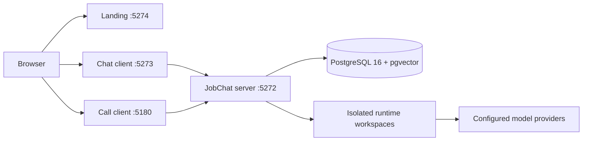

<div align="center">
  
  <h1>Get Jobs Done. All of Them.</h1>
  <p><strong>A self-hosted workspace for building and collaborating with a dedicated team of AI contacts.</strong></p>

  <p>
    <a href="https://github.com/GodblessJack/jobchat-open-source/blob/main/LICENSE"></a>
    
    
    <a href="https://github.com/GodblessJack/jobchat-open-source/actions/workflows/ci.yml"></a>
  </p>
  <p>English | <a href="README.zh-CN.md">简体中文</a> | <a href="https://jobchat.io">Website</a></p>
</div>

## Overview

JobChat lets you create AI contacts with distinct roles, knowledge, and capabilities, then work with them through direct messages, group conversations, and realtime calls. The application includes the chat runtime, landing page, call interface, local authentication, PostgreSQL persistence, vector memory, and a production gateway.

The open-source edition is self-contained: it does not require a global Claude Code installation, a legacy chat project, or a hosted Supabase project for its core local workflow.


<details>
  <summary>View the landing page</summary>
  <br />
  
</details>

## Features

- **Configurable AI contacts** — combine a role, identity, instructions, and capability packs.
- **Direct and group conversations** — realtime messaging, mentions, attachments, and conversation history.
- **Realtime calls** — browser-based audio/video interaction with transcript persistence.
- **Persistent memory** — PostgreSQL and pgvector-powered recall with optional embedding providers.
- **Local-first authentication** — username/password login with access and refresh tokens.
- **Self-hosted runtime** — Claude Agent SDK bundled as an npm dependency, with isolated session workspaces.
- **Production gateway** — one entry point for the landing page, chat, calls, API, and WebSocket traffic.

## Architecture



In production, `gateway.js` serves the built applications on port 3000 and proxies API and WebSocket traffic to the JobChat server. See [docs/ARCHITECTURE.md](docs/ARCHITECTURE.md) for process boundaries and data-flow details.

## Repository layout

```text
.
├── jchat/                 # Chat client, server, database schema, and tests
├── meeting/               # Realtime call client
├── landing/               # Public landing page and brand assets
├── docs/                  # Architecture, configuration, and release assets
├── licenses/              # Third-party license texts
├── gateway.js             # Production static server and reverse proxy
├── docker-compose.yml     # Local PostgreSQL + pgvector service
└── .github/               # CI, dependency updates, and contribution templates
```

## Quick start

### Prerequisites

- Node.js 22+ and npm 10+
- Docker with Compose v2, or an existing PostgreSQL 16+ instance with pgvector
- An Anthropic API key for contact replies
- Optional: OpenAI, Google GenAI, Qwen, and Slack credentials for their respective integrations

### 1. Install dependencies

```bash
git clone https://github.com/GodblessJack/jobchat-open-source.git
cd jobchat-open-source

npm ci
npm --prefix jchat ci
npm --prefix meeting ci
npm --prefix landing ci
```

### 2. Create local configuration

```bash
cp .env.example .env
cp jchat/.env.example jchat/.env
cp landing/.env.example landing/.env
cp meeting/.env.example meeting/.env
```

Edit `.env` and `jchat/.env`:

1. Set the same local database password in `POSTGRES_PASSWORD` and `DATABASE_URL`.
2. Set `ANTHROPIC_API_KEY`.
3. Generate two different JWT secrets with `openssl rand -hex 64`.
4. Set `JCHAT_LOCAL_PASSWORD` to at least 12 characters for the local development account.
5. Keep `JCHAT_SESSIONS_ROOT` and `FILES_ROOT` at absolute paths outside the repository. Create them with permissions suitable for your user, or change them to another external absolute path.

See [docs/CONFIGURATION.md](docs/CONFIGURATION.md) for every setting and browser-key safety notes.

### 3. Start and initialize PostgreSQL

```bash
npm run db:up
npm --prefix jchat run bootstrap
```

`bootstrap` applies the current schema, creates or updates the local account from `JCHAT_LOCAL_USERNAME`, and seeds three example contacts. It is safe to run again; completed migrations are skipped.

### 4. Start the development stack

```bash
npm run dev
```

| Application | URL |
| --- | --- |
| Landing page | http://localhost:5274/ |
| Chat | http://localhost:5273/chat |
| Call client | http://localhost:5180/call/ |
| API health | http://localhost:5272/health |

Sign in with `admin` unless you changed `JCHAT_LOCAL_USERNAME`, using the development password you configured.

## Production

Build all applications:

```bash
npm run build
```

Start the compiled server and gateway in separate processes:

```bash
# Process 1
npm --prefix jchat start

# Process 2
npm start
```

The gateway listens on `http://localhost:3000/`. Configure production values in the module `.env` files before building, and run the server with `NODE_ENV=production`.

### Container image

```bash
docker build -t jobchat:0.1.0 .
docker run --rm \
  -p 3000:3000 -p 5272:5272 \
  --env-file jchat/.env \
  -v jobchat-sessions:/data/jchat-sessions \
  -v jobchat-files:/data/jobchat/files \
  jobchat:0.1.0
```

Use a `DATABASE_URL` reachable from inside the container. The image runs as the unprivileged `node` user and starts both the compiled server and gateway. Before redistributing a prebuilt image, review the proprietary runtime terms in `docs/RUNTIME_TERMS.md`.

## Verification

```bash
npm run typecheck
npm test
npm run lint
npm run build
```

The default test suite uses deterministic test-only configuration and does not call hosted model APIs. To run the real SDK integration test explicitly:

```bash
RUN_SDK_INTEGRATION=1 npm --prefix jchat test -- tests/integration/sdk-pipeline.test.ts
```

Only do this with a valid provider credential and an understanding of the associated API usage.

## Security and privacy

- Never commit real `.env` files, session workspaces, uploads, or database dumps.
- Restrict browser-side model keys by HTTP referrer and API scope.
- Use independent random JWT secrets and rotate any credential that may have been exposed.
- Keep runtime workspaces outside the source tree to prevent development-only files from entering the runtime.
- Review [SECURITY.md](SECURITY.md) before reporting a vulnerability or deploying a public instance.

## Contributing

Read [CONTRIBUTING.md](CONTRIBUTING.md) for the development workflow and [CODE_OF_CONDUCT.md](CODE_OF_CONDUCT.md) for community expectations. Changes to behavior should include tests and documentation.

## Third-party notices and license

JobChat is licensed under [Apache License 2.0](LICENSE). Third-party components, source locations, modifications, and media attributions are documented in [THIRD_PARTY_NOTICES.md](THIRD_PARTY_NOTICES.md), with additional license texts in [`licenses/`](licenses/).

The Claude Agent SDK and bundled Claude Code binary are proprietary Anthropic dependencies, not Apache-licensed JobChat code. Their use, authentication, billing, distribution, and anti-resale requirements are described in [docs/RUNTIME_TERMS.md](docs/RUNTIME_TERMS.md). Review those terms before offering a hosted service or distributing a prebuilt image.

Built-in contacts that reference public figures are fictional simulations for software demonstration. They are not affiliated with, endorsed by, or speaking for those individuals.

## Changelog

See [CHANGELOG.md](CHANGELOG.md) for release history.
