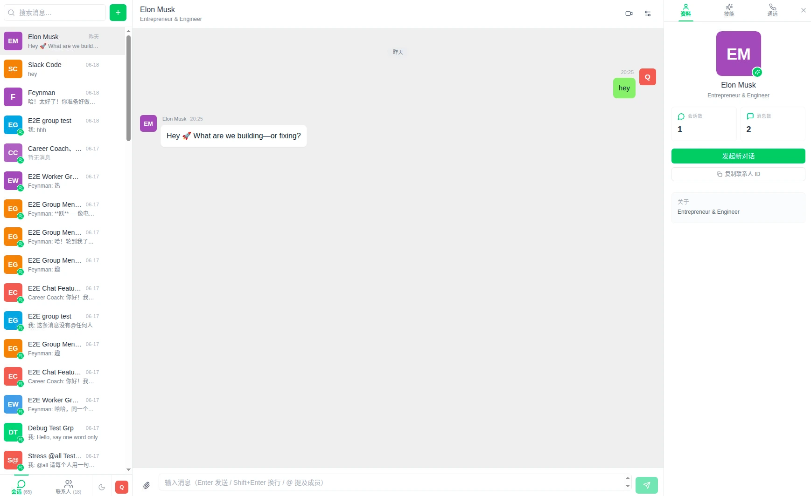
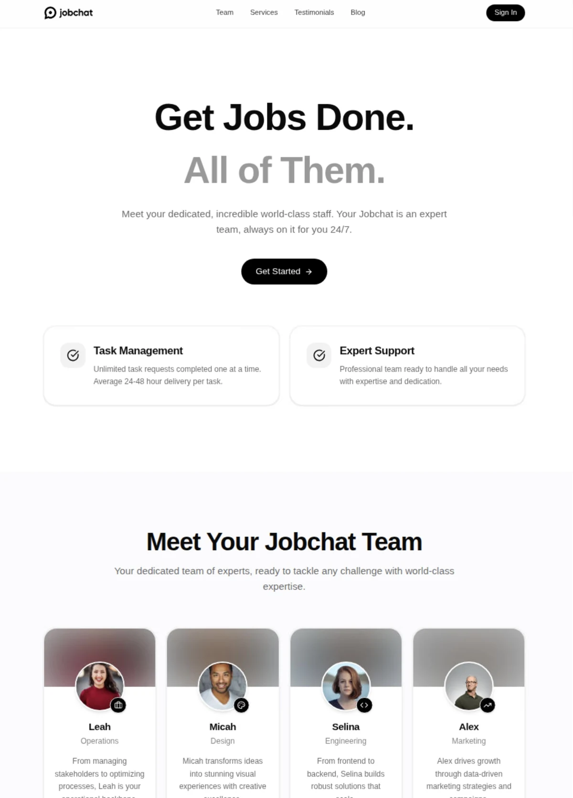

<div align="center">
  
  <h1>JobChat</h1>
  <p><strong>可自托管的 AI 团队协作工作台。</strong></p>
  <p>创建拥有不同角色与能力的 AI 联系人，通过单聊、群聊和实时通话开展工作。</p>

  <p>
    <a href="https://github.com/GodblessJack/jobchat-open-source/blob/main/LICENSE"></a>
    
    
    <a href="https://github.com/GodblessJack/jobchat-open-source/actions/workflows/ci.yml"></a>
  </p>
  <p><a href="README.md">English</a> · <a href="https://jobchat.io">官网</a> · <a href="docs/ARCHITECTURE.md">架构</a> · <a href="docs/CONFIGURATION.md">配置</a> · <a href="CONTRIBUTING.md">贡献指南</a></p>
</div>



## 为什么选择 JobChat？

JobChat 让每位 AI 联系人拥有独立的角色、说明和可复用能力，并将它们集中在熟悉的协作界面中。你可以在自己的基础设施上保存会话与数据，而不必依赖托管工作台。

仓库包含完整的本地核心流程：聊天与通话前端、后端服务、本地认证、PostgreSQL 持久化、向量记忆、数据库迁移和生产打包。运行核心流程不需要全局安装 Claude Code，也不依赖托管 Supabase 项目。

## 主要功能

- **专业 AI 联系人**：为不同工作配置角色、说明和能力组合。
- **单聊与群聊**：支持实时消息、提及、附件和会话历史。
- **实时通话**：支持浏览器音视频通话，并将转录保存回会话。
- **长期记忆**：通过 PostgreSQL 与 pgvector 召回相关上下文。
- **默认自托管**：提供本地账号、隔离运行时工作区，不依赖托管控制面。
- **统一生产入口**：通过 gateway 提供前端、API、文件与 WebSocket 服务。

<details>
  <summary><strong>查看落地页截图</strong></summary>
  <br />
  
</details>

## 快速开始

### 环境要求

- Node.js 22+ 与 npm 10+
- Docker Compose v2，或 PostgreSQL 16+ 与 pgvector
- 用于联系人回复的 Anthropic API Key

OpenAI、Google GenAI、Qwen 和 Slack 配置均为可选项，只在使用对应集成时需要。

### 1. 克隆并安装依赖

```bash
git clone https://github.com/GodblessJack/jobchat-open-source.git
cd jobchat-open-source

npm ci
npm --prefix jchat ci
npm --prefix meeting ci
npm --prefix landing ci
```

### 2. 配置本地环境

```bash
cp .env.example .env
cp jchat/.env.example jchat/.env
cp landing/.env.example landing/.env
cp meeting/.env.example meeting/.env
```

修改 `.env` 和 `jchat/.env`：

1. 让 `POSTGRES_PASSWORD` 与 `DATABASE_URL` 使用相同的数据库密码。
2. 设置 `ANTHROPIC_API_KEY`。
3. 使用 `openssl rand -hex 64` 生成两个不同的 JWT 密钥。
4. 设置至少 12 位的 `JCHAT_LOCAL_PASSWORD`。
5. 将 `JCHAT_SESSIONS_ROOT` 和 `FILES_ROOT` 设置为**仓库之外**、当前用户可写的绝对路径。

全部变量与可选服务配置见[配置指南](docs/CONFIGURATION.md)。

### 3. 初始化数据库

```bash
npm run db:up
npm --prefix jchat run bootstrap
```

该命令会执行迁移、创建或更新本地账号，并安装三个示例联系人。重复执行是安全的。

### 4. 启动 JobChat

```bash
npm run dev
```

| 应用 | 地址 |
| --- | --- |
| 聊天 | http://localhost:5273/chat |
| 落地页 | http://localhost:5274/ |
| 通话 | http://localhost:5180/call/ |
| API 健康检查 | http://localhost:5272/health |

使用 `admin` 或 `JCHAT_LOCAL_USERNAME` 中配置的账号，以及你设置的本地开发密码登录。

## 生产运行

构建全部应用，然后分别启动服务端和 gateway：

```bash
npm run build

# 进程 1：API 与实时服务
npm --prefix jchat start

# 进程 2：前端应用与 3000 端口 gateway
npm start
```

构建前请将各模块环境文件改为生产配置，并以 `NODE_ENV=production` 运行服务端。

### Docker

```bash
docker build -t jobchat:0.1.0 .
docker run --rm \
  -p 3000:3000 -p 5272:5272 \
  --env-file jchat/.env \
  -v jobchat-sessions:/data/jchat-sessions \
  -v jobchat-files:/data/jobchat/files \
  jobchat:0.1.0
```

容器以非 root 的 `node` 用户同时启动编译后的服务端与 gateway。`DATABASE_URL` 必须从容器内可达。分发预构建镜像前，请阅读[运行时条款](docs/RUNTIME_TERMS.md)。

## 架构概览

```text
浏览器
   │
   ├── 落地页 / 聊天 / 通话
   │
   ▼
生产 gateway :3000
   │
   ▼
JobChat 服务端 :5272 ─── PostgreSQL 16 + pgvector
   │                     └── 本地认证与文件存储
   └── 隔离运行时工作区 ─── 已配置的模型服务
```

开发环境中，各前端由独立的 Vite 服务提供；生产环境中，`gateway.js` 提供构建后的应用，并代理 API、文件和 WebSocket 流量。进程边界与数据流详见[架构指南](docs/ARCHITECTURE.md)。

<details>
  <summary><strong>目录结构</strong></summary>

```text
.
├── jchat/                 # 聊天前端、服务端、数据库结构和测试
├── meeting/               # 实时通话前端
├── landing/               # 落地页与品牌素材
├── docs/                  # 使用指南与产品截图
├── licenses/              # 第三方许可证文本
├── gateway.js             # 生产静态服务与反向代理
├── docker-compose.yml     # 本地 PostgreSQL + pgvector
└── .github/               # CI、依赖更新与社区模板
```

</details>

## 文档导航

| 文档 | 内容 |
| --- | --- |
| [架构指南](docs/ARCHITECTURE.md) | 进程、数据流与运行时边界 |
| [配置指南](docs/CONFIGURATION.md) | 环境变量与模型服务配置 |
| [安全审计](docs/SECURITY_AUDIT.md) | 发布安全检查与依赖策略 |
| [运行时条款](docs/RUNTIME_TERMS.md) | 专有 Claude Agent SDK 的使用与分发条款 |
| [贡献指南](CONTRIBUTING.md) | 开发与 Pull Request 流程 |
| [更新日志](CHANGELOG.md) | 版本历史 |

## 开发检查

```bash
npm run typecheck
npm test
npm run lint
npm run build
npm run audit
```

默认测试使用专用测试配置，不调用线上模型 API。真实 SDK 集成测试需要显式启用：

```bash
RUN_SDK_INTEGRATION=1 npm --prefix jchat test -- tests/integration/sdk-pipeline.test.ts
```

仅在拥有有效服务凭证并了解相关 API 用量的情况下启用。

## 安全说明

不要提交真实 `.env`、凭证、会话工作区、上传文件或数据库导出。运行时数据必须放在源码目录之外；使用相互独立的 JWT 密钥，并通过 Referrer 和 API 权限限制浏览器侧模型 Key。

安全漏洞请按照 [SECURITY.md](SECURITY.md) 中的流程私下报告。

## 参与贡献

欢迎贡献。提交 Pull Request 前，请阅读[贡献指南](CONTRIBUTING.md)和[行为准则](CODE_OF_CONDUCT.md)。行为变更应同时包含测试和文档。

## 许可证与声明

JobChat 采用 [Apache License 2.0](LICENSE)。第三方组件与素材来源见 [THIRD_PARTY_NOTICES.md](THIRD_PARTY_NOTICES.md)，附加许可证文本位于 [`licenses/`](licenses/)。

Claude Agent SDK 及其 bundled 二进制是 Anthropic 的专有依赖，不属于 JobChat 的 Apache 许可范围。提供托管服务或分发预构建镜像前，请阅读 [docs/RUNTIME_TERMS.md](docs/RUNTIME_TERMS.md)。

基于公众人物的内置联系人仅为虚构演示，不代表相关人物本人，也不存在隶属或背书关系。
